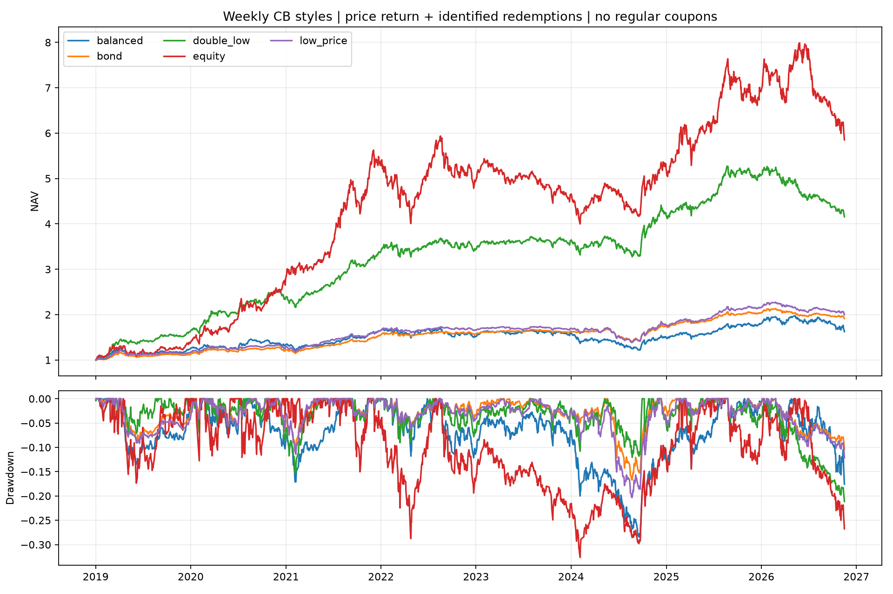
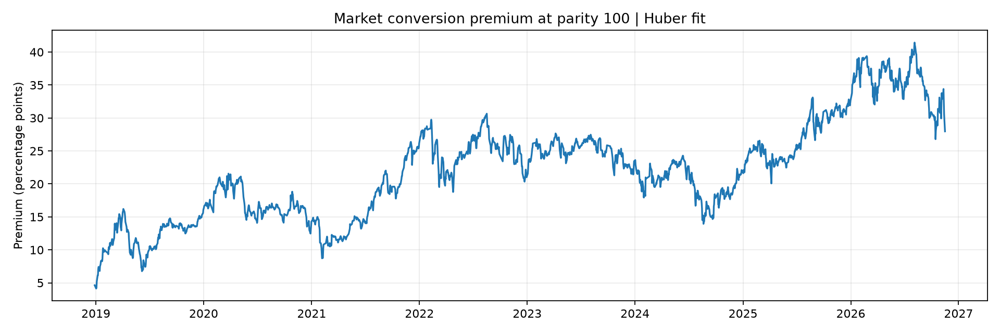

# 可转债五类周度风格策略

一个 `strategy.py` 完成 Tushare / AKShare 取数、SQLite 存储、五风格选券、风险退出、每日记账和结果导出。无需 Excel、VBA、Wind 或 iFinD。

**当前版本已完成 2019-01-02 至 2026-11-16 的五组合全区间回测，1,908 个交易日均有有效账本。** 这是加入风险过滤与退出规则后的版本；收益采用价格收益口径，不含常规年度票息。完整验证见 [VALIDATION.md](VALIDATION.md)。



## 五类指标

每周按指标升序取合格池最低 10%，数量为 `max(1, round(N*0.1))`，同分按代码排序，调仓时等金额配置。

| 风格 | 排序指标 |
|---|---|
| 偏股 | 转股溢价率 |
| 偏债 | 纯债溢价率 |
| 低价 | 转债收盘价 |
| 双低 | 收盘价 + 转股溢价率（百分点） |
| 平衡 | `abs(转股平价 / 纯债价值 - 1)` |

例如价格 120、转股溢价率 20%，双低值是 **140**。五个组合可重叠。低溢价率不保证低风险。

## 风险与交易规则

- 正常选券、再平衡按周：上一周末收盘指标，下一周首个交易日开盘成交。节假日使用交易日历；起点在周中时，首次建仓用前一交易日指标。
- 风险过滤先于分位排名。剔除正股已知 ST/退市风险、已公告赎回/停止交易，以及前一日收盘价低于 **90 元**的转债。90 元是固定研究参数，未根据收益优化。
- 股票名称历史由 Tushare 全市场 `namechange` 分页获取，与转债正股映射连接；没有可核验名称历史时不当作风险已排除。事件公告日后才生效，并尊重名称正式生效日，避免使用当天公告的未知发布时间。
- 周末到开盘前已公开的新风险同样阻止买入。风险日常检查，已持有风险券在下一可交易日开盘退出；正常轮换仍是周度。风险退出不等同每日重排组合。
- 周内数量保持不变，权重随价格漂移。买不到的额度留现金，不找替代券；卖不掉的持仓冻结，不能假设停牌前已退出。
- 已确认的整日停牌，仅沿用最后估值并标记 `confirmed_halt_stale_mark`；这不是可成交价格。复牌时按实际行情计入跳变。停牌记录来自 `suspend_d`，结合股票与转债同时停复牌的规则核对。
- 买卖均按成交额扣除单边 5bp，总摩擦参数可调整。允许碎份额，不模拟最小交易单位、盘口容量或排队成交；日线开盘成交属于研究近似，不是实盘成交保证。
- 已识别的赎回按登记日和付款日记应收款、现金，保留公告来源。任何无法解释的持仓价格缺失仍使后续绩效无效，绝不默认兑付面值或用零收益隐藏缺失。

原五风格选券思路来自原工作表、Python 及东北证券《可转债研究框架：从理论到策略》（2024-08-23，第 28–29、33 页）。本版本按使用者确认加入上述风险规则，故不可与未过滤的旧净值直接视为同一策略。

## 运行

Python 3.11+，在项目目录：

```powershell
python -m venv .venv
.\.venv\Scripts\python.exe -m pip install -r requirements.txt
# 在本机环境设置 TUSHARE_TOKEN，勿写入源码或 Git。
.\.venv\Scripts\python.exe strategy.py self-test
.\.venv\Scripts\python.exe strategy.py run --start 20190101 --end 20261116
```

需要 Tushare 的 `cb_basic`、`cb_daily`、`cb_share`、`trade_cal`、`namechange`、`suspend_d` 权限。网络中断有限重试；权限和数据错误直接报出。请求分页缓存可续跑，不生成模拟数据替代。

```powershell
# 已有本地数据库时重算
python strategy.py research --start 20190101 --end 20261116
# 相同参数在线运行成功后，完全离线重现
python strategy.py research --start 20190101 --end 20261116 --offline
# 可选：只读复用另一个仓库的赎回快照，核对日行情覆盖
python strategy.py run --start 20190101 --end 20261116 --reuse-repo "D:\Github Repository\Convertible-Bond-Pricing-Research"
```

`--db` 指定数据库，`--out` 指定结果目录，`--cost-bps` 指定单边摩擦，`--fraction` 指定底部分位，`--check-code` 指定 AKShare 核对个券。默认路径相对程序所在目录。

普通行情、名称与余额可随请求日期更新；附带的公告事件文件是经过本次历史核对的研究快照。扩展历史或用于日后信号前，必须更新公告事件并重新检查覆盖，不能将旧事件快照当成实时风险服务。

## 数据补充和审计

保持一个 Python 主程序，附带 CSV 是可审计的数据输入：

- `risk_events.csv`：公告风险事件与来源。程序忽略其中早期名称历史条目，统一使用完整 `namechange` 历史计算 ST 状态。英科停止交易、天创到期公告等人工核验事件有原始公告链接。
- `verified_redemptions.csv`：济川、太阳的到期兑付记录，覆盖供应商缺漏，附原始公告链接。
- `quote_overrides.csv`：2025-03-28 的三条真实新浪历史行情补充，记录来源及相邻日成交量单位核对。只补 OHLCV，不编造缺失估值指标，也不覆盖冲突价格。

SQLite 保留 `cache`（请求、来源、抓取时间）、`bars`、`bonds`、`balances`、`risk_blocked`、`quote_overrides`、`signals`、`trades`、`holdings`、`nav`、`issues` 等表。历史退市券保留，不用当前存续券名单倒推。

```sql
SELECT style, signal_date, execution_date, ts_code, factor, target_weight
FROM signals WHERE execution_date='20261116' ORDER BY style,rank;
SELECT reason,COUNT(*) FROM trades GROUP BY reason;
SELECT issue,COUNT(*) FROM issues GROUP BY issue;
```

## 百元平价估值

按日拟合 `转股溢价率 = a + b / 转股平价`，采用原 Python 的 Huber 稳健回归：平价严格处于 50–130，已披露余额大于 1 亿元。余额公告日严格早于当日，不用今天的余额填历史；缺余额的券排除并报告覆盖。市场估值指标为 `a+b/100`，单位百分点。这是独立市场估值序列，不是第六个交易组合。



## 结果文件

`results/` 包括 `signals.csv`、`trades.csv`、`nav.csv`、`issues.csv`、`metrics.csv`、`annual_returns.csv`、`curve.csv`、`coverage.csv`、`crosscheck.csv`、`run.json` 和两张图。完整持仓数量在 SQLite `holdings` 表。

公开仓库 `examples/` 只保存汇总指标与图表；原始数据库及详细账本保留本机并由 Git 忽略。最初未加风险过滤的结果保存在本地 `baseline_original/`，用于对照。

结果是**扣设定交易摩擦后的价格收益，加已识别赎回，不含常规票息**。停牌估值约定可能低估区间波动；数据供应商会修订历史，无法保证原始发布版本。参数和规则在看过历史后确定，应另做未来样本验证，历史表现不代表预期收益。

## 接口与资料

[Tushare 日行情](https://tushare.pro/document/2?doc_id=187) · [基本信息](https://tushare.pro/document/2?doc_id=185) · [转股余额公告](https://tushare.pro/document/2?doc_id=247) · [股票更名](https://tushare.pro/document/2?doc_id=100) · [AKShare 债券](https://akshare.akfamily.xyz/data/bond/bond.html)

复习 pandas / NumPy 可直接看程序的 `read_sql_query`、`groupby`、带主键验证的 `merge`、布尔筛选、滞后价格 `shift`、`np.isfinite` 和累计最高值 `np.maximum.accumulate`。重点是日期对齐、公告可见性、缺失值语义和现金守恒。
