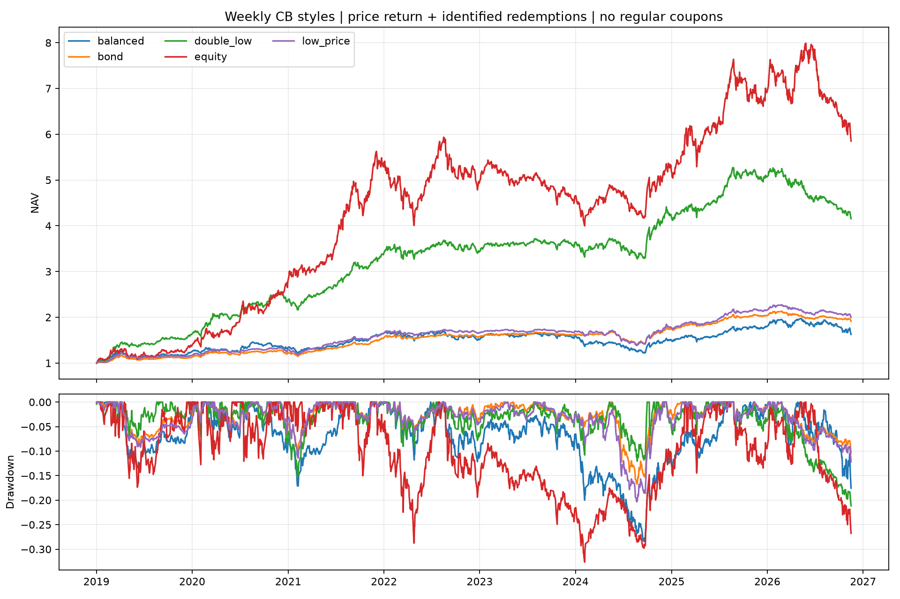

# 修复与验证（2026-11-17）

用户确认采用：保留五类因子和周度调仓，增加当时已公开风险的过滤与退出规则。

## 验收结果

- 五类组合全部覆盖 **2019-01-02—2026-11-16，1,908 个交易日**，共 9,540 条有效日净值；未解决估值记录为 **0**。
- 404 个正常建仓/调仓日，73,946 条选券记录，347,603 条持仓日记录。
- 89,836 笔交易记录，包括 1,462 笔风险退出、88,356 笔正常周度交易和 18 笔赎回。
- 线上与离线的净值、交易、选券、指标、回归、问题记录逐项一致。
- 全部日手续费与成交费用汇总一致，现金非负；每笔普通成交与风险退出均有正开盘价、正成交量，成交价等于对应开盘价。
- SQLite 完整性检查 `ok`。11 项测试通过：因子公式、未来数据扰动不影响过去信号、风险信息时滞、风险过滤先于排名、固定数量、费用、未成交现金、冻结持仓、下一开盘风险退出、停牌退出等待、赎回记账等测试场景。
- 净值和百元平价图已检查，覆盖完整区间。

## 根因与修复

1. 旧仓库的名称历史不完整，不能将缺记录当作非 ST。改用全市场名称变更历史分页取数，按公告和生效日处理，未知状态排除。
2. 部分退市/信用风险持仓没有事前退出约束。新增已公告 ST/退市、赎回/停止交易和固定 90 元价格风险线；只能在事件已知后的可交易开盘退出。
3. 英科已于 2021 年公告停止交易，供应商后续残留行情不可解释为持续可买卖。加入当时原始公告，天创的到期公告同样补入风险事件。
4. 正常停牌不等于永久坏账。使用真实停复牌记录确认、冻结数量、沿用最后估值，复牌真实跳变进入收益，保留审计标记。
5. 2025-03-28 三条 Tushare 缺行由真实新浪 OHLCV 补齐，并用相邻日核对成交量单位；没有补造平价或债底。

## 保留的限制

这是日线成交近似下、扣单边 5bp 摩擦的**价格收益研究**，不含常规年度票息；不是完整总回报或实盘成交承诺。仍有 61 条已确认停牌估值、718 条供应商非交易估值、1 条赎回等待估值、307 条风险退出冻结、35 条未成交现金槽记录，均明确保留，未用虚构卖出掩盖。

风险规则在查看过历史后确定，未进行未来样本验证。不同数据源债底不能混用；公告快照不代表实时风险覆盖。旧的未过滤实现和结果保留在本地 baseline_original/，Git 也保留原提交。当前修复结果见 examples/metrics.csv 和 examples/annual_returns.csv。

## 原始证据示例

- [英科 2021-06-23 停止交易公告](https://disc.static.szse.cn/download/disc/disk02/finalpage/2021-06-23/f642e1a8-6f07-4de2-8416-a52018734b55.PDF)
- [天创 2026-05-26 到期提示](https://static.cninfo.com.cn/finalpage/2026-05-26/1225328759.PDF)
- [帝欧 2025-06-04 停牌公告](https://static.cninfo.com.cn/finalpage/2025-06-04/1223750796.PDF)
- [正丹 2024-05-07 停牌公告](https://static.cninfo.com.cn/finalpage/2024-05-07/1219987200.PDF)
- [普利 2025-01-05 风险公告](https://static.cninfo.com.cn/finalpage/2025-01-05/1222237959.pdf)

